**Junior Software Developer at Vértice.** By day I build and maintain the OneClick platform in C# and .NET. After hours I build **Gabaro**, a finance SaaS for construction companies that already runs in production for a real client.

The dashboard is live: a GitHub Action reads my repositories every 6 hours and redraws it. Each spike in the activity line is a day I committed; the Gabaro blocks are real roadmap tasks, read straight from <a href="https://github.com/NicolasPascoal/Expense-Management-Project/blob/main/STATUS.md"><code>STATUS.md</code></a>.

## Currently shipping

**Vértice · OneClick** — Junior Software Developer

- Build features, fix bugs and support the OneClick platform
- APIs, Oracle queries and schema changes, reports, screens and data exports
- Testing, UAT, releases and code review in a Git/GitHub workflow
- Evolve product modules and business rules, with technical documentation

`C#` `.NET Framework 4.8` `ASP.NET MVC / Web API` `SQL / Oracle` `NHibernate` `jQuery / Kendo UI`

## Projects

| Project | What it does | Built with |
|---|---|---|
| **[Gabaro](https://github.com/NicolasPascoal/Expense-Management-Project)** | Multi-tenant finance SaaS for construction projects: budgets with alerts, cash flow, material requests, CSV/XLSX import and an audit trail. Live in production with a real client. | Flask · PostgreSQL · React + TS · Docker · GitHub Actions |
| **[FTV Payments](https://github.com/NicolasPascoal/ftv-project)** | Payment management that sends WhatsApp reminders on its own when a fee goes overdue. Separate services orchestrated with Docker Compose. | Python · React + TS · MySQL · whatsapp-web.js |
| **[Cofre](https://github.com/NicolasPascoal/cofre)** | Local password manager. The vault is encrypted on disk with AES-256-GCM, with the key derived from the master password via scrypt. | Bun · ElysiaJS · TypeScript |
| **[Product Inventory](https://github.com/NicolasPascoal/product-inventory.api)** | Product and raw-material inventory control, with a separate API and front end. ([front end](https://github.com/NicolasPascoal/product-inventory)) | Quarkus · Java · TypeScript |

<b>Full history</b>

 

**Vértice · OneClick** — Junior Software Developer · *Sep 2026 – present*

**ARIKI** — IT Support Analyst · *Jul 2026 – Sep 2026*
Tier 1/2 service desk within SLA, Active Directory users and permissions, infrastructure monitoring with Zabbix and Grafana.

**PRODESAN** — IT Infrastructure & Full Stack Development Intern · *Jul 2024 – Jul 2026*
REST APIs in Python (Flask + SQLAlchemy) with React and TypeScript front ends, MySQL modeling and tuning, supporting production systems, monitoring with Zabbix and ticketing in GLPI.

**Education** — B.Sc. in Information Systems, Universidade Santa Cecília (2024 – 2027) · Technical diploma in Business Administration, Senac Santos (2021 – 2023)

**Languages** — Portuguese (native) · English (advanced)

 

**Hiring, a project, or just want to talk code? → [Find me on LinkedIn](https://www.linkedin.com/in/nicolaspascoaldev/)**
